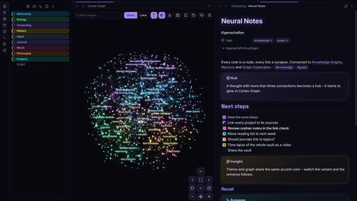

# Cortex

A deep-space theme for [Obsidian](https://obsidian.md) with a violet glow and glass surfaces.
Made as the companion theme for the [Cortex Graph](https://github.com/LowKI2/cortex-graph) plugin, but works on its own.

## Features

- **Dark: deep space** – near-black background, faint nebula and starfield
- **Light: daylight** – soft lavender white with a stronger accent
- Headings as a color gradient with a subtle glow
- Internal links light up on hover like a graph node
- Glass menus, dialogs, popovers and command palette
- Tags as small pills, callouts and code in the Cortex palette
- Obsidian's core graph view uses the Cortex colors
- Respects `prefers-reduced-motion`



## Fonts

Built in, no internet needed: **Inter** for text and interface, **Space Grotesk** for headings (both variable, latin subset, SIL Open Font License – see `OFL.txt`). Via Style Settings you can switch the text to your system font or use the text font for headings too. Fonts set in Obsidian's own appearance settings still take priority.

## Color variants

Violet (default), Cyan, Amber and Emerald – each in dark and light. Every accent color in the theme is derived from the variant.

## Starfield

A faint starfield behind the sidebars in dark mode, drawn with CSS only. Optional slow drift.

## Extra checkbox types

| Markdown | Meaning |
|---|---|
| `- [/]` | in progress |
| `- [>]` | forwarded |
| `- [<]` | scheduled |
| `- [!]` | important |
| `- [?]` | question |
| `- [-]` | cancelled |
| `- [*]` | star |
| `- [i]` | info |
| `- [I]` | idea |
| `- [b]` | bookmark |

## Cortex callouts

```md
> [!neuron] A thought with many connections
> [!insight] Something you realised
> [!synapse] A connection between two ideas
> [!signal] Something that needs attention
```

## Works with Cortex Graph

The theme publishes `--cortex-accent`, `--cortex-accent-rgb` and `--cortex-space-bg`.
[Cortex Graph](https://github.com/LowKI2/cortex-graph) 3.5.0+ picks them up, so glow, labels and space background of the 3D graph follow the chosen variant.

## Options

**With Cortex Graph (3.5.0+):** all theme options – color variant, fonts, starfield, nebula, heading glow and gradient, extra checkboxes – are in the plugin settings under *Cortex theme*. No extra plugin needed.

**Without the plugin:** 
With the [Style Settings](https://github.com/mgmeyers/obsidian-style-settings) plugin you can choose the color variant and switch off starfield, nebula, heading glow, heading gradient or the extra checkboxes, or let the stars drift.

## Install

Settings → Appearance → Themes → Manage → search for **Cortex**.

## License

MIT
